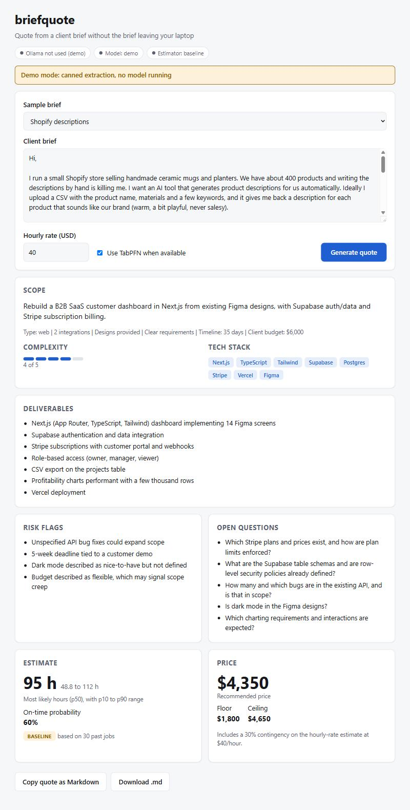
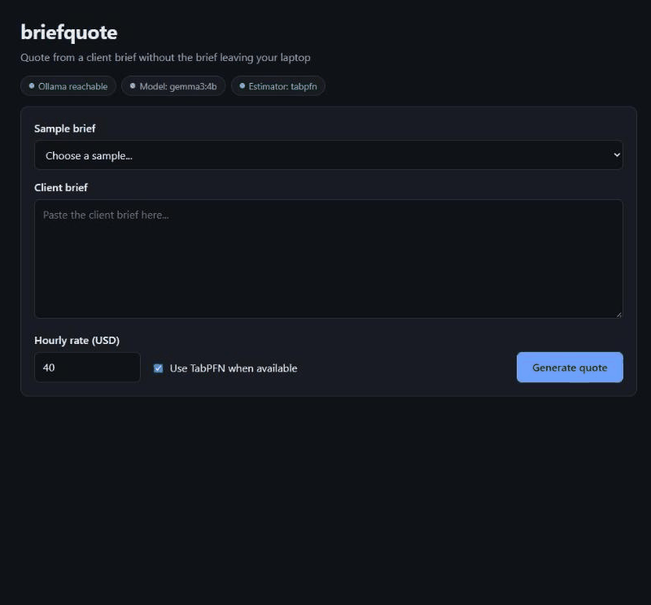

# briefquote

[](https://github.com/Moin105/briefquote/actions/workflows/tests.yml)

Live replay of real runs, nothing to install: https://briefquote-replay.vercel.app

Quote from a client brief without the brief leaving your laptop. Paste a client brief, and briefquote uses an open-weight model (Gemma, running locally through Ollama) to extract a structured scope as JSON: deliverables, tech stack, complexity, integrations, unknowns to ask the client, and risk flags.

## Why open-weight

- **Privacy:** client briefs often contain confidential business details. Nothing is sent to a third-party API.
- **Zero per-call cost:** quote as many briefs as you like.
- **Works offline:** once the model is pulled, no internet is needed.

## Status

- **Day 1:** brief-to-scope extraction. Done.
- **Day 2:** TabPFN-based hour and price estimator trained on your past jobs (`data/past_jobs.csv` is a **synthetic** example dataset, not real client work; see `data/README.md`), plus a client-ready Markdown quote. Done.
- **Day 3:** local web UI (`briefquote serve`). Done.
- **TabPFN path:** verified on real model weights on 2026-10-15 (`tabpfn-v3.5`, 30-row synthetic example history).

**Important: the bundled history is synthetic.** `data/past_jobs.csv` holds 30 invented jobs written for the demo. They are not real client work and they encode simple rules (more complexity and integrations mean more hours; unclear requirements run late). Estimates are only meaningful after you replace it with your own history. briefquote warns on stderr and labels quotes, the web UI and the replay while the bundled file is in use.

## Setup

1. Install Ollama from <https://ollama.com>.
2. Pull the model: `ollama pull gemma3:4b`. On CPU-only machines `gemma3:1b` is faster (use `--model gemma3:1b` or set `BRIEFQUOTE_MODEL`).
3. Clone the repository and create a virtual environment:

```bash
git clone https://github.com/Moin105/briefquote.git
cd briefquote
python -m venv .venv
source .venv/bin/activate        # Windows: .venv\Scripts\activate (Git Bash: source .venv/Scripts/activate)
pip install -e ".[dev]"             # tests and the baseline estimator; takes a couple of minutes
pip install -e ".[dev,estimator]"   # optional instead: also installs TabPFN (pulls PyTorch)
```

Python 3.11 or newer is required. The `estimator` extra is optional: without it, estimates use the nearest-neighbour baseline and say so.

Environment variables: `OLLAMA_HOST` (default `http://localhost:11434`), `BRIEFQUOTE_MODEL` (default `gemma3:4b`).

## Usage

```bash
briefquote doctor
briefquote extract examples/briefs/saas-dashboard.txt --pretty
cat brief.txt | briefquote extract - --pretty
```

`doctor` checks that Ollama is reachable and the model is installed, and prints the exact commands to fix it. Run the tests (no Ollama needed) with `pytest`; the real-TabPFN test is marked `slow` and skips itself if the model weights are unavailable.

```bash
# Estimate from a saved scope (no Ollama needed)
briefquote estimate examples/sample_extraction.json --rate 40
briefquote estimate examples/sample_extraction.json --json
briefquote estimate examples/sample_extraction.json --no-tabpfn   # baseline only

# Full pipeline: brief -> scope (Ollama) -> estimate -> quote
briefquote quote examples/briefs/saas-dashboard.txt --rate 50 --save-scope scope.json
```

## Web UI





*Real run on CPU. The wait is shortened: the model took about a minute, and the elapsed counter in the frames is genuine. The history behind the estimate is synthetic example data.*

```bash
briefquote serve --open      # real model via Ollama, opens your browser
briefquote serve --demo      # canned extraction, no Ollama needed
```

Demo mode returns one canned extraction whatever brief you paste, so it is for trying the interface without Ollama running. The screenshot in this README comes from a real Gemma run.

The page talks to one endpoint, `POST /api/quote` with JSON like `{"brief": "...", "hourly_rate": 50}` (rate between 5 and 500); `GET /api/health` reports status.

Options: `--port 8765`, `--model gemma3:1b`, `--history your.csv`, `--no-tabpfn`. Pick a sample brief or paste your own, set your hourly rate, and click Generate quote. The page shows the scope, an hours range (p10 to p90), the price, which estimator produced it, and buttons to copy or download the quote as Markdown. CPU inference can take a few minutes, so the page shows a live elapsed counter.

**Privacy:** the server binds to `127.0.0.1` only, the page is a single file with no external requests (no CDN, fonts or analytics), and there is no telemetry. The brief goes from your browser to your local server to your local Ollama, and nowhere else.

**Troubleshooting:** on Windows, a PowerShell window opened before you installed Ollama will not find it on PATH. Close it and open a new one. If the status pill says Ollama is not reachable, start Ollama and run `ollama pull gemma3:4b`.

## Replay demo

`site/` is a static, pre-computed replay of the three sample briefs. It shows the real Gemma extractions from `examples/outputs/` run through the real estimator and quote code (TabPFN where available), fitted on the 30 synthetic example jobs, so the numbers show how the pipeline works, not what a real freelancer's history would say. Nothing on the page calls a model; only the hourly-rate arithmetic is recomputed in the browser. The page is one self-contained file with no external requests. A deployed copy is at https://briefquote-replay.vercel.app. Regenerate it with:

```bash
python scripts/build_replay.py      # add --no-tabpfn for the baseline estimator
```

## How the estimate works

[TabPFN](https://github.com/PriorLabs/TabPFN) is a pretrained transformer for small tabular datasets, so it works with 20 to 30 past jobs instead of thousands. briefquote fits it on your history (the bundled 30-row file is synthetic example data; project type, complexity, deliverables, integrations, design provided, requirements clarity) to predict hours, price and the chance of delivering on time. Quantiles (p10, p50, p90) give a range rather than a single number. If TabPFN is not installed or its weights cannot be loaded, a nearest-neighbour baseline (k=5, no ML dependencies) is used and the quote says so.

Each price point (floor, recommended, ceiling) is the average of the history-predicted price and `hours x rate x (1 + contingency)` at the p10, p50 and p90 quantile respectively, rounded to the nearest 50, so floor <= recommended <= ceiling always holds. Contingency is 10%, plus 10% when requirements are unclear, plus 5% per risk flag, capped at 35%. The reported on-time probability is clamped to 5% to 95%, and quotes built on fewer than 100 past jobs say they are a rough guide.

**Before and after on the sample brief** (30 synthetic example jobs, not real history): for the hand-written `examples/sample_extraction.json`, the baseline gave 95 h (48.8 to 112 h) and 60% on time; TabPFN gave 91.9 h (80.1 to 102.4 h). TabPFN's range is tighter, but that does not mean it is more accurate. The history is invented, so this only shows that the integration works and produces a range. Nothing here validates accuracy against real work.

**Why the on-time figure swings.** The raw TabPFN on-time probability depends almost entirely on `has_clear_requirements`, because the synthetic data ties that flag to lateness: all 12 rows with unclear requirements are not delivered on time (0% delivered), versus 17 of 18 (94%) with clear requirements. With the same classifier and the same scope, raw on-time is 97.6% when the flag is true and 4.0% when it is false. Gemma's committed extraction of the SaaS brief (flag false) gives 3.7%, and the same extraction with only the flag set to true gives 94.1%. So the swing is one feature the synthetic data links to lateness. It is not instability, and it shows the classifier mostly learned the rule planted in the data. The reported figure is clamped to 5% to 95%.

**The hours figures differ by extraction.** The 91.9 h figure is for the hand-written `examples/sample_extraction.json`. Gemma's own extractions of the same brief give different hours, and they also vary from run to run: a live run gave 59.2 h with a price of $2,700, and the committed extraction in `examples/outputs/saas-dashboard.json` gives 66.8 h with a price of $3,050.

TabPFN weights are gated: the first run needs a one-time license acceptance with Prior Labs (a browser login, or set the `TABPFN_TOKEN` environment variable from <https://ux.priorlabs.ai>). Set `TABPFN_NO_BROWSER=1` to fail fast instead of opening a browser.

**License note:** TabPFN model weights are licensed for non-commercial use only (Prior Labs states a commercial license must be requested separately). Anyone selling quotes built on briefquote must obtain a commercial TabPFN license or use the `--no-tabpfn` baseline, which has no such restriction. The briefquote code itself is MIT.

**Windows setup note:** TabPFN's own browser login crashes on Windows with `WinError 10038` because its prompt uses `select` on stdin. Use an API key instead: accept the license at <https://platform.priorlabs.ai/account/licenses>, create a key under API Keys, and set it for the session without leaving it in command history:

```powershell
$k = Read-Host "Paste TabPFN API key" -AsSecureString; $env:TABPFN_TOKEN = [System.Net.NetworkCredential]::new("", $k).Password; Remove-Variable k
```

## Limitations

Checked on 8 real client briefs ([docs/real-brief-check.md](docs/real-brief-check.md)), small and judged by one person:

- All 8 returned valid output, but only 3 were usable as a first draft without major edits, and 2 dropped about half the scope.
- Data work was labelled `ai_automation` 3 times, and the project type feeds the estimator.
- Quoted client sentences appeared as risk flags in 4 of 8 briefs.
- The bundled history is synthetic, so prices and hours are illustration, not validated estimates.
- The extraction is a checklist and clarifying-question generator, not a replacement for reading the brief.
- Long briefs now raise Ollama's context window automatically, up to a limit; beyond it the tool errors and asks you to shorten or split the brief instead of silently truncating.

## Sample quote (trimmed)

```markdown
# Project quote

## Summary
Rebuild a B2B SaaS customer dashboard in Next.js from existing Figma designs...

## Deliverables
- Supabase authentication and data integration
- Stripe subscriptions with customer portal and webhooks
- ...

## Estimate
Expected effort is about 95 hours, with a likely range of 48.8 to 112 hours.
Based on a bundled example history of 30 synthetic jobs (not real past work), this is only an illustration: roughly a 60% chance of delivering on time.
_Method: baseline, based on 30 bundled example jobs (synthetic demo data, replace with your own history)._

## Price
- Recommended: **$4,350**
- Floor: $2,150
- Ceiling: $5,250

Includes a 30% contingency (10% base, +10% if requirements are unclear, +5% per risk flag, capped at 35%)...
```

## Use your own history

The bundled history is synthetic (see `data/README.md`). Replace `data/past_jobs.csv` (or pass `--history your.csv`). One row per finished job, with these columns:

| column | meaning |
| --- | --- |
| `project_type` | one of `web, mobile, data, ai_automation, design, writing, devops, other` |
| `complexity` | 1 to 5 |
| `deliverables_count` | number of deliverables |
| `integrations_count` | third-party systems integrated |
| `has_design_provided` | `true` / `false` |
| `has_clear_requirements` | `true` / `false` |
| `hours_actual` | hours you really spent |
| `price_usd` | what you charged |
| `outcome` | `delivered`, `delivered_late` or `cancelled` |

Cancelled jobs are ignored for hours and price but count toward the on-time probability. 20 or more rows work well. Do not trust estimates from the bundled synthetic file.

## Example output

```json
{
  "summary": "Rebuild a B2B SaaS customer dashboard in Next.js from existing Figma designs, with Supabase auth/data and Stripe subscription billing.",
  "project_type": "web",
  "deliverables": [
    "Next.js (App Router, TypeScript, Tailwind) dashboard implementing 14 Figma screens",
    "Supabase authentication and data integration",
    "Stripe subscriptions with customer portal and webhooks",
    "Role-based access (owner, manager, viewer)",
    "CSV export on the projects table",
    "Profitability charts performant with a few thousand rows",
    "Vercel deployment"
  ],
  "tech_stack": ["Next.js", "TypeScript", "Tailwind", "Supabase", "Postgres", "Stripe", "Vercel", "Figma"],
  "complexity": 4,
  "integrations_count": 2,
  "has_design_provided": true,
  "has_clear_requirements": true,
  "unknowns": [
    "Which Stripe plans and prices exist, and how are plan limits enforced?",
    "What are the Supabase table schemas and are row-level security policies already defined?",
    "How many and which bugs are in the existing API, and is that in scope?",
    "Is dark mode in the Figma designs?",
    "Which charting requirements and interactions are expected?"
  ],
  "risk_flags": [
    "Unspecified API bug fixes could expand scope",
    "5-week deadline tied to a customer demo",
    "Dark mode described as nice-to-have but not defined",
    "Budget described as flexible, which may signal scope creep"
  ],
  "client_timeline_days": 35,
  "budget_mentioned_usd": 6000.0
}
```

## License

MIT

Started 2026-10-14 for the DEV Hacktoberfest Open-Source AI Challenge Week 2.
